<p align="center">
  
</p>

<p align="center">
  
  
  
  
  
  
</p>

<p align="center">
  <b>An AI study assistant that does more than answer questions.</b><br>
  CampusPilot reads your course material, builds a realistic study plan, tracks quiz results,<br>
  and, when you fall behind, proposes a revised plan that you review and approve.
</p>

<p align="center">
  <a href="#-overview">Overview</a> ·
  <a href="#-features">Features</a> ·
  <a href="#-screenshots">Screenshots</a> ·
  <a href="#-architecture">Architecture</a> ·
  <a href="#-the-recovery-agent">Agent</a> ·
  <a href="#-getting-started">Getting started</a> ·
  <a href="#-evaluation">Evaluation</a> ·
  <a href="#-roadmap">Roadmap</a>
</p>


## 📖 Overview

University students often have the material but no structure: they cannot tell which topics are weak or what to study next, and a missed week quietly breaks the whole plan.

A normal chatbot answers questions. **CampusPilot** also looks at your progress and acts on it.

1. You upload course PDFs and enter exam dates.
2. It builds a day-by-day schedule that fits your daily study hours.
3. You take quizzes written from your own notes, and the app flags weak topics.
4. When tasks are missed or quiz scores drop, a **LangGraph agent** re-plans, explains why, and **waits for your approval** before changing anything.

> **Design principle:** code does the maths, the AI does the language. Scheduling, validation and quiz grading run in plain Python so results are exact. Gemini is used only to answer from your documents, write quiz questions, and explain changes.


## ✨ Features

| Module | What it does |
|---|---|
| **📚 Course Knowledge Assistant** | Upload PDFs and ask questions. Answers come only from your material, with `[file, page]` citations. Anything outside the documents is refused rather than guessed. |
| **🗓️ Personalised Study Planner** | Add courses, exam dates and topics with priority and hours. The planner fills each day up to your limit, studies earlier exams first, and warns you honestly when time is not enough. |
| **📊 Academic Progress Analysis** | Generates multiple-choice quizzes from your PDFs, grades them exactly, and labels each topic **weak**, **untested** or **on track** with the reason. |
| **⚡ Adaptive Recovery Agent** | A LangGraph workflow that detects weak topics or missed tasks, rebuilds the schedule, validates it, explains the change, and pauses for human approval. |
| **🕘 History and Usage** | Past quizzes, agent revisions and finished tasks, plus token counts, latency and estimated cost per feature. |

Also included: edit and delete for courses, topics and tasks, a document manager, automatic retries when the Gemini API is busy, and a responsive animated UI.


## 🖼️ Screenshots

<table>
  <tr>
    <td align="center"><b>Dashboard</b><br>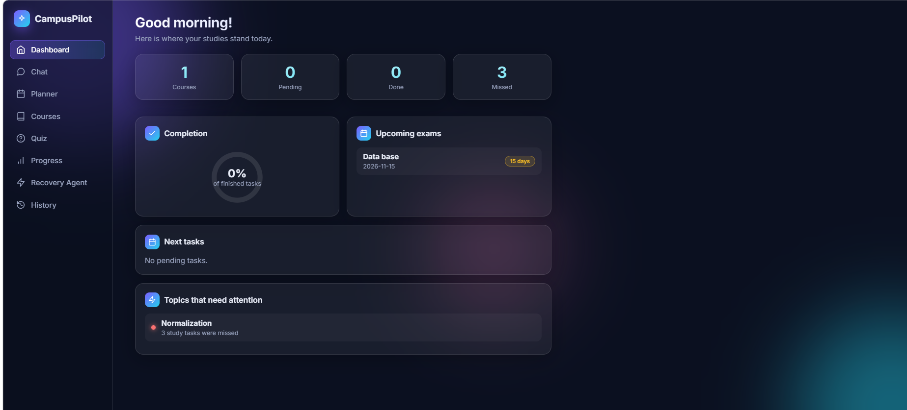</td>
    <td align="center"><b>Course Assistant</b><br>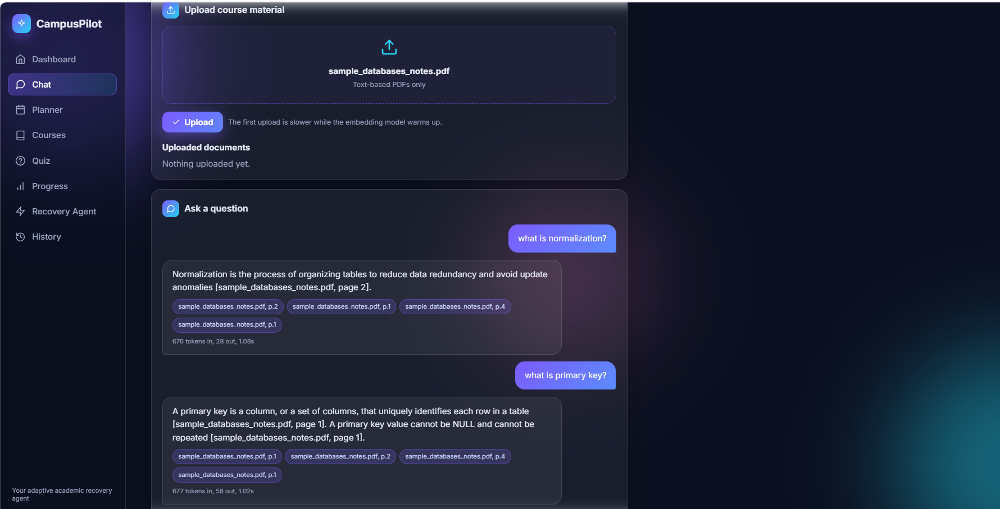</td>
  </tr>
  <tr>
    <td align="center"><b>Study Planner</b><br>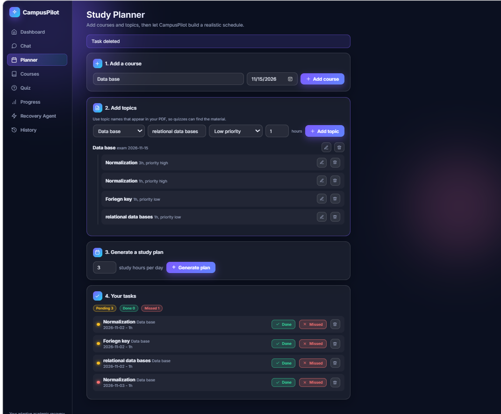</td>
    <td align="center"><b>Practice Quiz</b><br>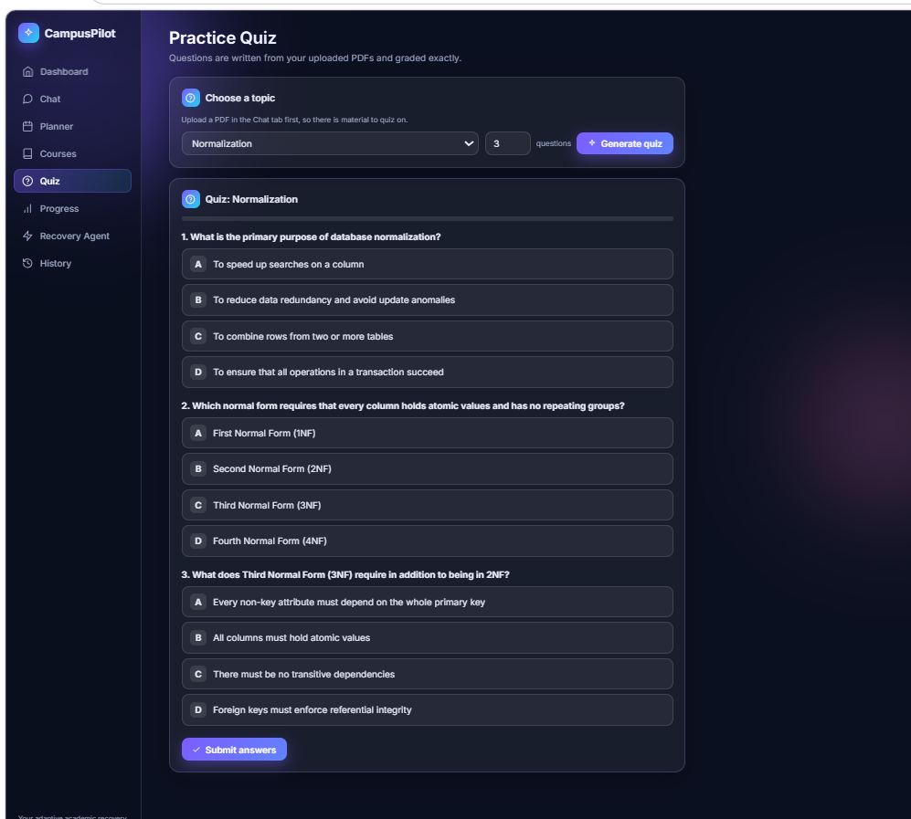</td>
  </tr>
  <tr>
    <td align="center"><b>Progress</b><br>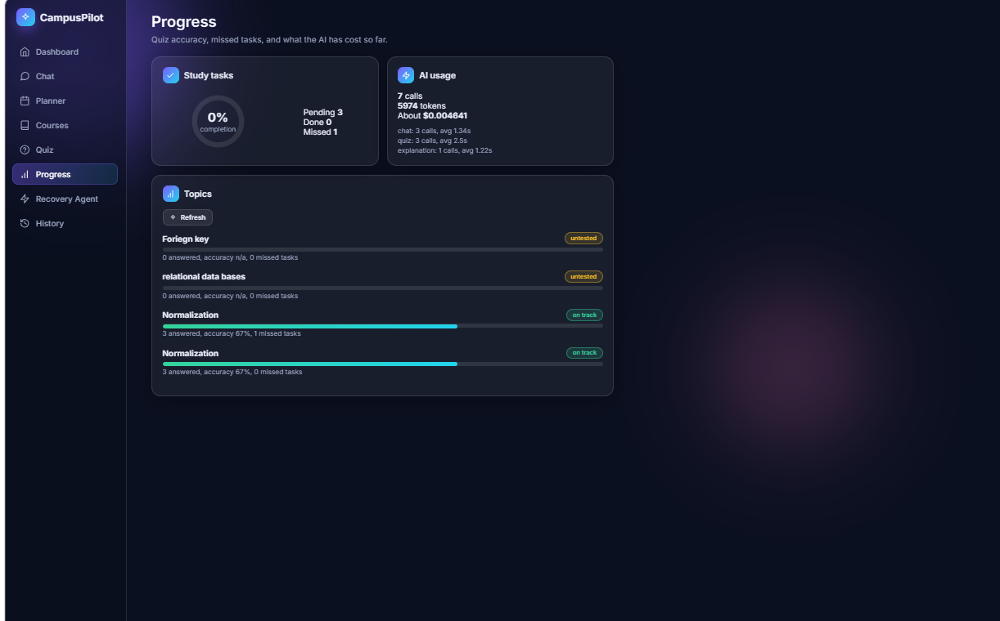</td>
    <td align="center"><b>Recovery Agent</b><br>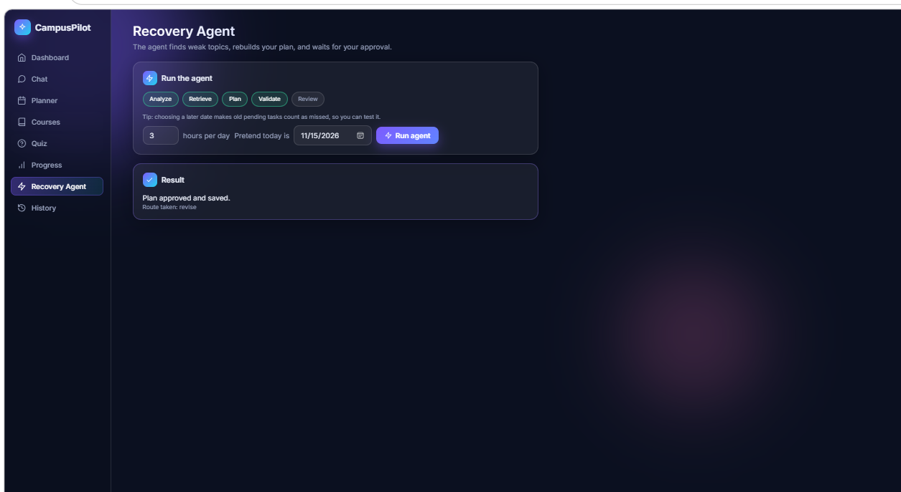</td>
  </tr>
  <tr>
    <td align="center"><b>Course Details</b><br>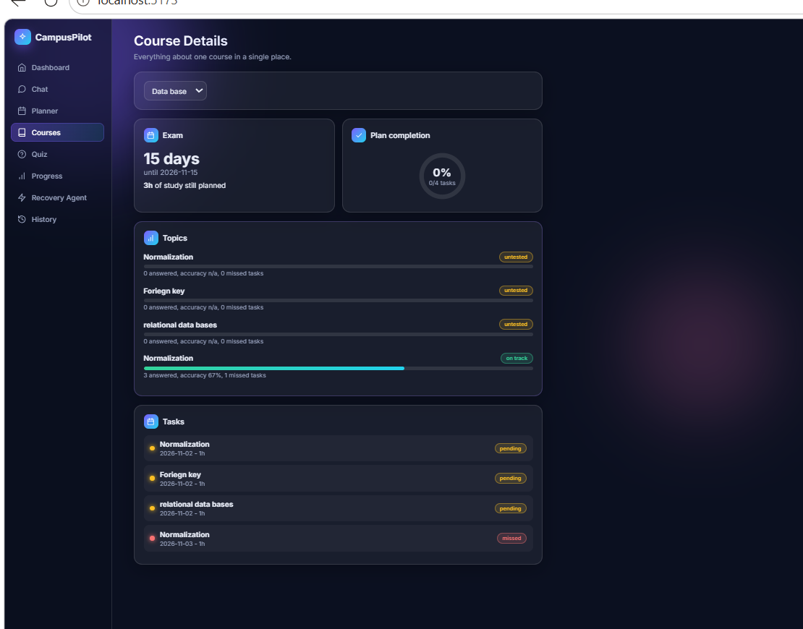</td>
    <td align="center"><b>History</b><br>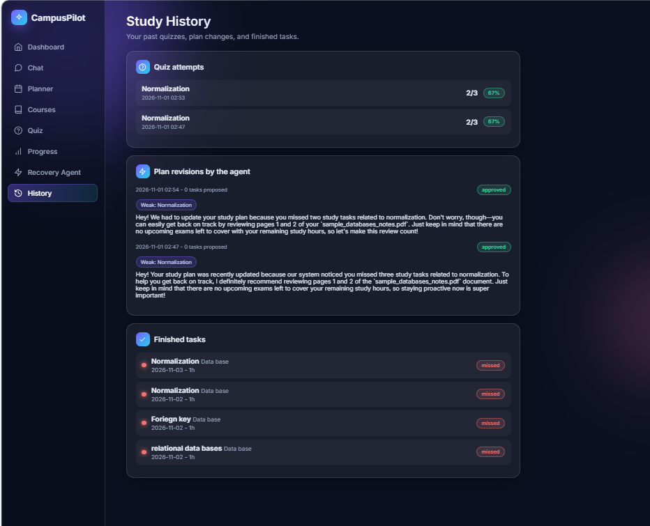</td>
  </tr>
</table>


## 🏗️ Architecture

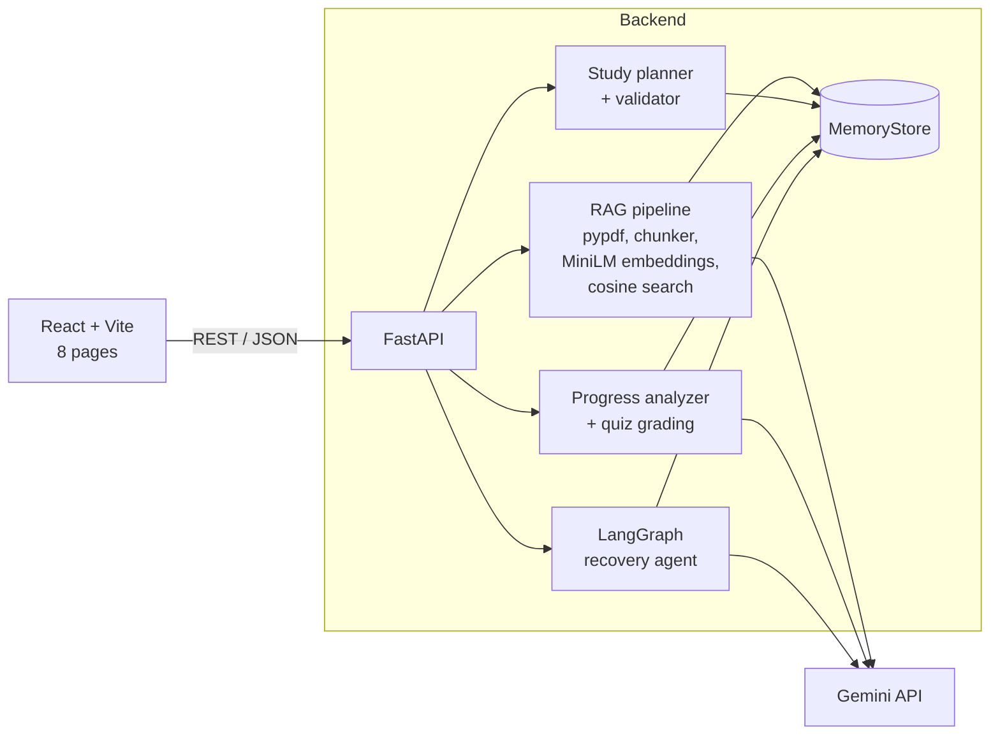

**How a question is answered (RAG):**

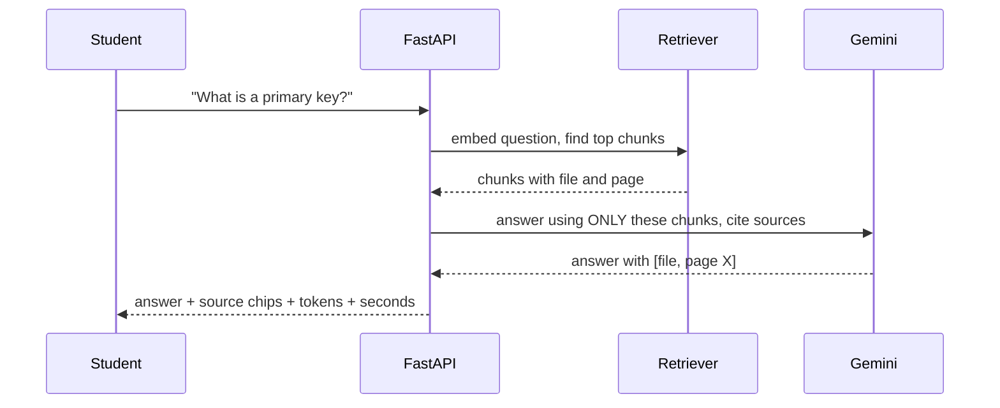


## ⚡ The Recovery Agent

<p align="center">
  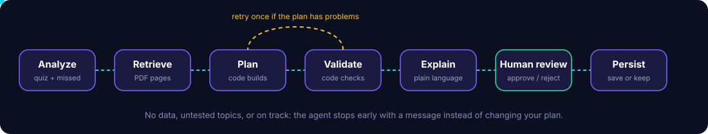
</p>

The agent is a LangGraph `StateGraph` with conditional routing, a validation loop and a human-in-the-loop pause.

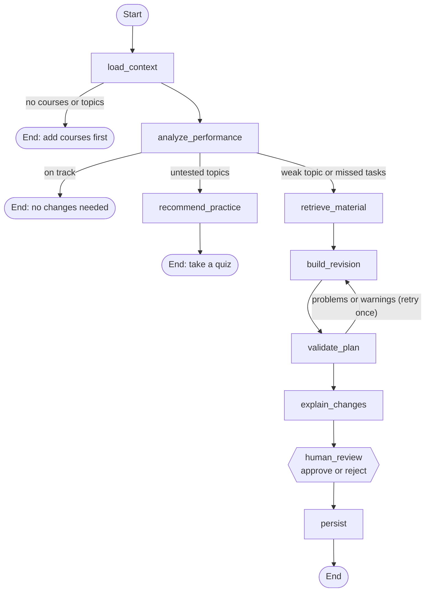

| Route | Triggered when | Result |
|---|---|---|
| `no_data` | No courses or topics exist | Stops with a message |
| `practice` | Topics have too little quiz data | Tells you which topics to quiz |
| `on_track` | Every topic is healthy | "No changes needed" |
| `revise` | A topic has quiz accuracy under 60% (with 2 or more answers) or 2 or more missed tasks | Builds a new plan and **pauses for approval** |

**Why it is safe to trust:**

- The proposed plan is stored as a *pending revision*. Your active plan only changes after you press **Approve**; **Reject** leaves it untouched.
- Weak topics get top priority and extra hours. If that plan has problems or does not fit, the agent retries once without the extra hours.
- A separate validator checks that no day exceeds your daily limit and nothing is scheduled on or after its exam.
- The agent keeps its state under a `thread_id`, so it can pause and resume between requests.


## 🧰 Tech stack

| Layer | Technology |
|---|---|
| Frontend | React, Vite, plain CSS (animated glass UI, no UI library) |
| Backend | FastAPI, Pydantic, Uvicorn |
| Agent orchestration | LangGraph (conditional edges, `interrupt`, checkpointer) |
| LLM | Google Gemini (model set in `.env`) |
| Retrieval | `sentence-transformers` (`all-MiniLM-L6-v2`), NumPy cosine similarity |
| Documents | `pypdf` |
| Storage | In-memory store (see [Roadmap](#-roadmap) for PostgreSQL) |

## 📁 Project structure

```text
Alphatron_Case_Study_project/
└── campuspilot/
    ├── backend/
    │   └── app/
    │       ├── main.py              # FastAPI app and routers
    │       ├── api/routes/          # documents, chat, courses, plans, tasks,
    │       │                        # quizzes, progress, agent, usage, history
    │       ├── agents/              # LangGraph: state, graph, checkpointer, nodes/
    │       ├── services/
    │       │   ├── ingestion/       # PDF parser, chunker, embedder
    │       │   ├── rag/             # retriever, answer generator
    │       │   ├── planner/         # scheduler, validator
    │       │   └── progress/        # analyzer, quiz generator
    │       ├── db/                  # memory_store.py
    │       ├── core/                # settings
    │       └── utils/               # Gemini retry, token and cost tracker
    ├── frontend/src/                # pages, shared components, API client
    ├── evaluation/                  # run_eval.py, scenarios, test documents
    └── docs/                        # screenshots and README graphics
```


## 🚀 Getting started

### Prerequisites

- Python 3.11
- Node.js 20 or newer
- A Google Gemini API key (create one in Google AI Studio)

### 1. Clone

```bash
git clone https://github.com/muzammilahmed321/Alphatron_Case_Study_project.git
cd Alphatron_Case_Study_project/campuspilot
```

### 2. Configure

Create a file named `.env` inside `campuspilot/` (it is git-ignored):

```env
GEMINI_API_KEY=your-key-here
GEMINI_MODEL=gemini-3.5-flash
```

Google retires model names from time to time. If you see a `404 NOT_FOUND` from Gemini, change `GEMINI_MODEL` to a current model.

### 3. Run the backend

```powershell
cd backend
python -m venv .venv
.\.venv\Scripts\Activate.ps1        # macOS/Linux: source .venv/bin/activate
pip install -r requirements.txt
uvicorn app.main:app --port 8000
```

Wait for `Application startup complete`. The first start downloads the embedding model (about 90 MB). Interactive API docs are at <http://localhost:8000/docs>.

> Run without `--reload`. Data is kept in memory, and auto-reload would wipe it every time you save a file.

### 4. Run the frontend

```powershell
cd frontend
npm install
npm run dev
```

Open <http://localhost:5173>. To point the UI at a different backend, create `frontend/.env` with `VITE_API_URL=http://your-backend:8000`.

### 5. Try it in two minutes

1. **Chat:** upload `evaluation/test_documents/sample_databases_notes.pdf`.
2. **Planner:** add a course with a future exam date and topics named `Normalization`, `SQL Joins`, `Transactions`, `Indexes`. Generate a plan.
3. **Quiz:** take a quiz on `Normalization` twice, answering wrongly on purpose.
4. **Recovery Agent:** run it, read the explanation, and approve or reject the new plan.


## 🔌 API overview

All routes are documented interactively at `/docs`.

| Area | Endpoints |
|---|---|
| Documents | `POST /documents/upload`, `GET /documents`, `DELETE /documents/{filename}`, `GET /documents/search` |
| Chat | `POST /chat/ask` |
| Courses and topics | `POST/GET /courses`, `PATCH/DELETE /courses/{id}`, `POST/GET /courses/{id}/topics`, `PATCH/DELETE /courses/{id}/topics/{topic_id}` |
| Plans | `POST /plans/generate`, `POST /plans/generate-and-save` |
| Tasks | `GET /tasks`, `GET /tasks/summary`, `PATCH/DELETE /tasks/{id}`, `POST /tasks/check-missed` |
| Quizzes | `POST /quizzes/generate`, `POST /quizzes/{id}/submit` |
| Progress | `GET /progress/topics`, `GET /progress/weak-topics` |
| Agent | `POST /agent/run`, `POST /agent/{thread_id}/decision` |
| Insights | `GET /history`, `GET /usage` |

## 🧪 Evaluation

An automated script exercises the running API against the criteria from the project proposal:

```powershell
# backend running on port 8000, venv active, from the backend folder
python ..\evaluation\run_eval.py
```

| Criterion | How it is checked |
|---|---|
| Answer accuracy and relevance | Keyword checks on answers to questions about a sample PDF |
| Grounding | Out-of-scope questions (for example, "capital of France") must be refused |
| Citations | Answers must reference a page |
| Schedule feasibility | No day over the limit; an impossible plan must produce a warning |
| Agent routing | `no_data`, `practice` and `revise` are each triggered and verified |
| Persistence of updates | Nothing changes before approval; approve saves the plan; reject keeps it |
| Latency and cost | Tokens, seconds and estimated cost per feature, from `/usage` |

Results are saved to `evaluation/results/eval_results.json`. If Gemini is busy or rate limited, affected checks are reported as skipped instead of failed. A manual, step-by-step test plan that uses the web UI is also available.

## 🛠️ Engineering decisions

- **Grounded answers.** The model is told to use only the retrieved passages and to say so when the answer is missing. Out-of-scope questions are part of the evaluation.
- **Code for exact work.** Scheduling, plan validation and quiz grading are deterministic Python. The LLM never does arithmetic.
- **Human in the loop.** Plan changes are proposals until approved, using LangGraph's `interrupt`.
- **Resilient API calls.** Busy (503) and rate-limit (429) responses are retried with a growing delay.
- **Cost visibility.** Every Gemini call records tokens, latency and estimated cost per feature.
- **Swappable storage.** All data access goes through one `MemoryStore` class, so a database version can replace it without touching the routes.

## ⚠️ Current limitations

- Data is stored **in memory**, so it resets when the backend restarts.
- No user accounts: everything belongs to a single shared workspace.
- Text-based PDFs only. Scanned documents need OCR, which is not included.
- Gemini free-tier limits can slow or temporarily block requests.
- Cost figures are estimates based on configured per-token prices.

## 🗺️ Roadmap

- [x] PDF ingestion, local embeddings and cited, grounded answers
- [x] Study planner with a code-side validator
- [x] Quizzes, exact grading and weak-topic analysis
- [x] LangGraph recovery agent with approval step
- [x] Evaluation script, usage and cost tracking
- [x] Animated React interface
- [ ] PostgreSQL with pgvector, replacing the in-memory store
- [ ] Persistent LangGraph checkpointer
- [ ] Authentication and per-user data
- [ ] Automated unit tests for planner, analyzer and routing
- [ ] Deployment (hosted frontend, backend and managed PostgreSQL)
- [ ] Notifications and calendar integration


<p align="center">
  Built by <a href="https://github.com/muzammilahmed321">@muzammilahmed321</a><br>
  <sub>Part of an AI engineering case study: LangGraph, RAG and a full-stack application.</sub>
</p>
